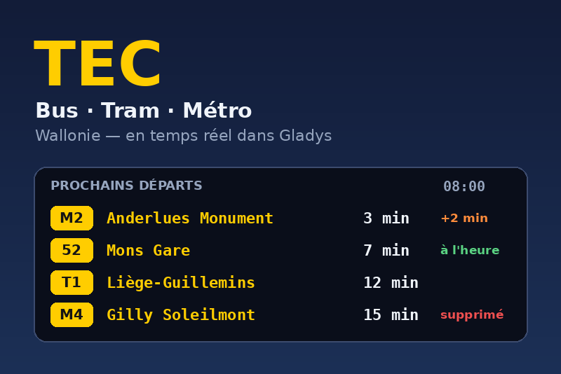

# TEC — Gladys Assistant integration

Next departures of the **TEC** network of Wallonia — buses, the Liège tram and
the Charleroi metro — in [Gladys Assistant](https://gladysassistant.com), with
**real-time delays, cancellations and disruptions**.



- One device per monitored stop (with an optional line filter): next departure
  in minutes, next bus with its destination and delay, following departure,
  list of the next departures, number of disruptions.
- **Scene triggers**: departure in N minutes, departure delayed, departure
  cancelled, new disruption.
- **Scene actions**: get the next departure (for a message), check whether a
  line is disrupted.
- **Dashboard widgets**: departure board of a stop, disruptions of your lines.
- Stop search by name, or around the houses of Gladys.
- **Cloud** integration, in English, French, German and Spanish.
- Requires **Gladys 5.1** or later.

User documentation: [English](docs/en.md) · [Français](docs/fr.md) ·
[Deutsch](docs/de.md) · [Español](docs/es.md).

## Data sources

| Data                               | Source                                                                                       | License   |
| ---------------------------------- | -------------------------------------------------------------------------------------------- | --------- |
| Timetable (GTFS)                   | [TEC open data](https://opendata.tec-wl.be/) — downloaded nightly, indexed locally           | CC0       |
| Delays, cancellations, alerts (RT) | [Belgian Mobility open data portal](https://data.belgianmobility.io/en/data.html?agency=tec) | CC BY 4.0 |

Source: LETEC – Open Data. Without an API key the real-time portal accepts 100
requests a day: the integration then reads it every 20 minutes. A free key
from its [developer portal](https://api-management-opendata-production.developer.azure-api.net/signup)
allows a refresh every minute.

## How it works

```
opendata.tec-wl.be ──(GTFS zip, conditional GET every 6 h)──► /data ──► index of the monitored stops
Belgian Mobility RT ──(trip updates + alerts, within the quota)──┐
                                                                 ▼
                     every 30 s: departures = timetable ⊕ real-time ──► states, scene events, widgets
```

The 440 MB `stop_times.txt` is streamed out of the archive and only the
departures of the monitored stops are kept: indexing the whole network takes
about 15 seconds and 170 MB of memory, once a day. The index is cached in
`/data`, so a restart is instant.

## Development

```bash
npm install
npm test                # node --test, no network
npm run lint
npm run format:check
```

Run it against a Gladys instance:

```bash
GLADYS_HOST_API_URL="http://localhost:1443" \
GLADYS_INTEGRATION_TOKEN="<token>" \
GLADYS_INTEGRATION_SELECTOR="tec" \
TEC_DATA_DIR=./data \
LOG_LEVEL=debug \
npm start
```

See [`CLAUDE.md`](CLAUDE.md) for the architecture and the project rules.

## Release

Describe the changes under `## [Unreleased]` in [`CHANGELOG.md`](CHANGELOG.md),
then run **Actions → Release** (patch, minor or major): the workflow bumps the
version in `package.json` and the manifest, tags, builds the multi-arch image
(`ghcr.io/gboulvin/letec`) and publishes the GitHub Release. The
decentralized Gladys store picks the new version up through the
`gladys-assistant-integration` topic of the repository.

Security issues: see [`SECURITY.md`](SECURITY.md).

## License

Apache-2.0. Not affiliated with the TEC (OTW) nor with the Belgian Mobility
Company.
